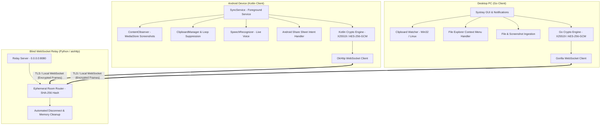
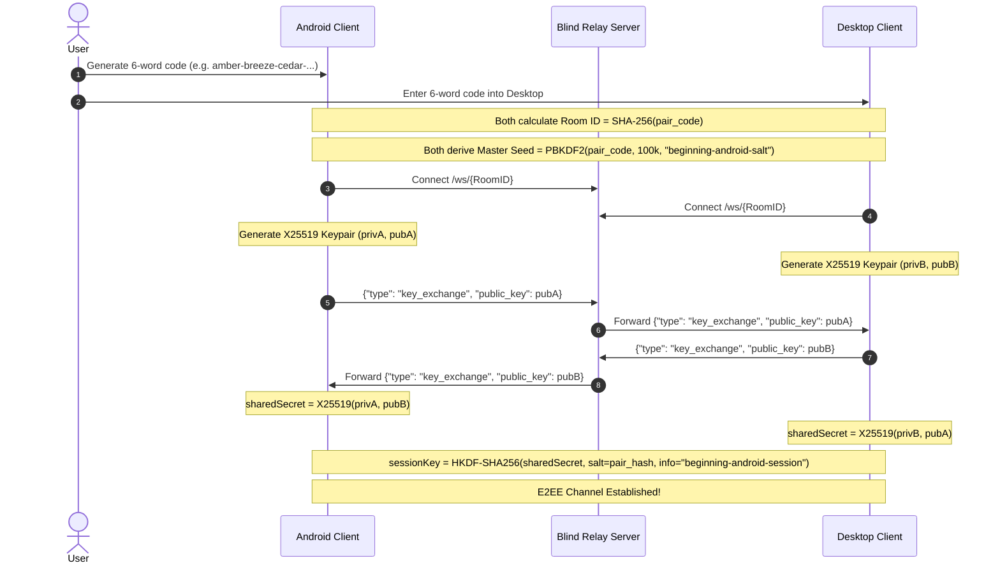
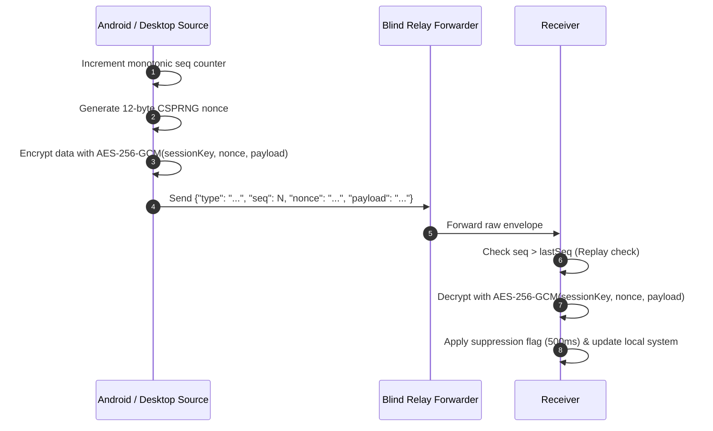

# Beginning Android — System Architecture & Design

This document details the canonical architecture, component relationships, data flow, and threat model of the **Beginning Android** cross-platform synchronization ecosystem.

---

## 1. High-Level Architecture Overview

Beginning Android connects mobile devices running Android with personal computers running Windows or Linux. It operates under a strict **zero-knowledge, client-side encrypted architecture**:

---

## 2. Component Breakdown

### 2.1 Android Client (`android/`)
The Android client is implemented in pure native Kotlin, compiled into a compact ~2.1 MB APK with minimal dependencies.

1. **`SyncService.kt` (Foreground Service)**:
   - Maintains a sticky background lifecycle with a low-priority persistent notification (`FOREGROUND_SERVICE_DATA_SYNC`).
   - Ensures continuous synchronization even when the app is in the background or the screen is off.
   - Coordinates clipboard watching, media store observation, and WebSocket event handling.

2. **`MediaStore` Screenshot `ContentObserver`**:
   - Observes `MediaStore.Images.Media.EXTERNAL_CONTENT_URI`.
   - On Android 13+ (API 33+), leverages `READ_MEDIA_IMAGES`; on older versions, uses `READ_EXTERNAL_STORAGE`.
   - Automatically detects freshly generated images under `Pictures/Screenshots` or DCIM within milliseconds of capture and triggers encrypted streaming to the desktop.

3. **Clipboard Management & Debouncing**:
   - Registers a `ClipboardManager.OnPrimaryClipChangedListener`.
   - Implements a **500ms suppression flag** (`ignoreNextChange`) whenever a clipboard write is executed programmatically from desktop payloads, eliminating ping-pong feedback loops.

4. **Speech-to-Text (`SpeechRecognizer`)**:
   - Integrates with Android's on-device speech engine in `MainActivity.kt`.
   - Transcribes spoken audio into text chunks and streams them in real-time over the encrypted socket directly to the desktop clipboard.

5. **System Share Sheet Integration**:
   - Declares intent filters for `android.intent.action.SEND` and `android.intent.action.SEND_MULTIPLE` in `AndroidManifest.xml`.
   - Accepts all MIME types (`*/*`), enabling users to share files from any third-party app (Gallery, Files, Drive, Browsers) directly to their PC.

---

### 2.2 Go Desktop Client (`desktop/`)
The desktop client is written in Go, compiled to a single static binary (<10 MB) without external runtimes (no Node.js, Electron, or Python needed on desktop).

1. **System Tray Lifecycle (`desktop/cmd/beginning-android/main.go`)**:
   - Manages a native tray icon using lightweight OS bindings.
   - Displays real-time connection status (`Connected`, `Connecting...`, `Disconnected`).
   - Provides quick actions: Pair Device, Open Screenshots folder, Open Received files folder, and Quit.

2. **Native Clipboard Watchers (`desktop/internal/clipboard/`)**:
   - **Windows**: Uses Win32 API clipboard notifications (`AddClipboardFormatListener` / `GetClipboardData`).
   - **Linux**: Interacts directly with X11 / Wayland clipboard buffers via pure Go implementations.
   - Enforces a thread-safe **500ms debounce and suppression lock** (`suppressJob`) during incoming sync events.

3. **Shell Context Menu Integration (`desktop/scripts/`)**:
   - Registers Windows Explorer right-click menu **"Send to Beginning Android"** using user-level registry entries (`HKCU\Software\Classes\*\shell\BeginningAndroid`).
   - Registers Linux file manager actions for Nautilus, Nemo, Thunar, and KDE Dolphin.
   - Invokes the running executable with CLI arguments (`beginning-android send <file>`).

4. **File Ingestion & Storage**:
   - Screenshots are automatically organized into:
     - Windows: `%USERPROFILE%\BeginningAndroid\Screenshots\`
     - Linux: `~/BeginningAndroid/Screenshots/`
   - Shared files land in:
     - Windows: `%USERPROFILE%\BeginningAndroid\Received\`
     - Linux: `~/BeginningAndroid/Received/`

---

### 2.3 Blind WebSocket Relay Server (`server/`)
The relay is an asynchronous WebSocket router implemented in Python (`aiohttp` / `websockets`).

1. **Zero-Knowledge Principle**:
   - The relay server never inspects, logs, or decrypts payload contents.
   - Frames are routed purely based on the WebSocket URL path: `/ws/{room_id}`, where `{room_id}` is the hex-encoded `SHA-256(clean_pair_code)`.
   - The relay does not possess the pair code seed, private keys, or session keys.

2. **Ephemeral Pairing Hub**:
   - Rooms are created on-demand when the first peer connects.
   - When the second peer connects, all incoming binary and text frames from one client are broadcast directly to the other peer.
   - Strict room isolation: each room permits a maximum of 2 active peers.

3. **Memory Cleanup & Leak Prevention**:
   - Upon peer disconnection, the socket is cleanly unregistered.
   - If both peers disconnect or a room becomes idle, the room data structure is garbage collected immediately.

---

## 3. Communication & Cryptographic Flow

### 3.1 Device Pairing & Session Handshake

---

### 3.2 Secure Data Streaming & Replay Protection

Every application envelope transmitted between Android and Desktop contains:
1. `type`: Packet purpose (`clipboard`, `screenshot`, `file_start`, `file_chunk`, `file_end`, `voice_stream`).
2. `seq`: A strictly monotonic increasing sequence integer (`1, 2, 3...`). Envelopes with `seq <= lastSeenSeq` are immediately discarded, preventing replay attacks.
3. `nonce`: A cryptographically secure 12-byte random initialization vector (Base64).
4. `payload`: Ciphertext sealed with `AES-256-GCM` using `sessionKey`.

---

### 3.3 Large File & Screenshot Chunking Protocol

To support multi-megabyte screenshots and arbitrary files without memory spikes or network buffering delays:
1. Senders break large streams into **64 KB (65,536 bytes) chunks**.
2. Each chunk is encrypted independently with its own 12-byte nonce.
3. A **5–10ms backpressure throttling delay** is enforced between chunk transmissions to preserve network stability on Wi-Fi links.
4. The receiver streams decrypted chunks directly into temporary files, moving to the destination directory upon receiving `file_end`.

---

## 4. Deployment Topologies

Beginning Android seamlessly supports two operational topologies:

| Mode | Use Case | Network Path | Relay Host |
|---|---|---|---|
| **Local Wi-Fi Hotspot** | Zero-internet, offline field operation, private local sync. | Direct LAN / Hotspot (`10.26.96.x`) | Local PC running `run-local-relay.bat` |
| **Internet Cloud Relay** | Cross-network sync across cellular (4G/5G) and home Wi-Fi. | Secure WebSocket over TLS (`wss://`) | Self-hosted VPS (Hetzner, Railway, Fly.io) |

---

## 5. Security & Threat Model

- **Relay Server Compromise**: Even if the relay server is completely controlled by an adversary, the attacker only sees encrypted binary frames. They cannot decrypt payloads or forge valid messages because they lack the X25519 private keys and PBKDF2 seed.
- **Eavesdropping on Local Hotspot**: Wireless traffic over open or shared Wi-Fi is protected by the authenticated AES-256-GCM session cipher.
- **Replay & Injection Attacks**: Envelopes lacking monotonic sequential sequence numbers are rejected by both clients.
